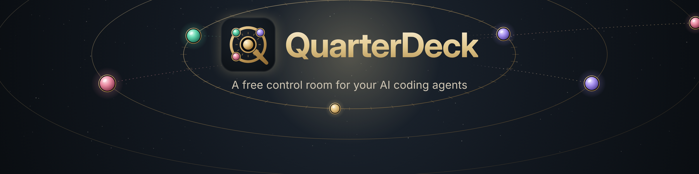

# QuarterDeck

**A free Windows control room for your AI coding agents.**

QuarterDeck shows every AI coding agent on your computer in one place: Claude Code, Codex, Gemini CLI and Antigravity.

- See what each agent is doing, what it costs and how much of your plan is left.
- Run your own tasks next to them, and let several models discuss, compare and build together in Agora.
- It runs on your computer and sends nothing to us.

**Download:** [quarterdeck-releases](https://github.com/quarterdeckui/quarterdeck-releases/releases). The first public release is on its way.

**Support:** one-time, any amount you choose, on [Buy Me a Coffee](https://buymeacoffee.com/quarterdeckui). Supporters get Agora's gift modes as a thank-you: send your machine code (QuarterDeck → ♥ Support us) and your gift code arrives by email.

**Contact:** quarterdeckui@gmail.com

---

**Türkçe:** QuarterDeck, yapay zekâ kod ajanların için ücretsiz bir Windows kontrol odası. Her ajanın ne yaptığını, ne harcadığını ve kotandan ne kaldığını tek yerde görürsün; senin bilgisayarında çalışır ve bize hiçbir şey göndermez. Destek tek seferliktir, tutarı sen seçersin: [Buy Me a Coffee](https://buymeacoffee.com/quarterdeckui). İletişim: quarterdeckui@gmail.com
